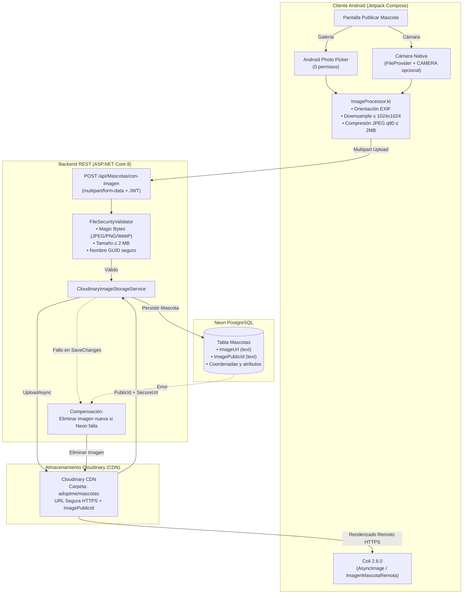

# AdoptMe — Sistema de Adopción Responsable de Mascotas
## Entrega #4 / Fase A: Imágenes Persistentes con Cloudinary y Gestión Estricta de Permisos

AdoptMe es una plataforma integral para la adopción y rescate responsable de mascotas, compuesta por una aplicación móvil nativa Android (desarrollada con **Kotlin y Jetpack Compose**) y un servicio backend REST (desarrollado con **ASP.NET Core 8 y PostgreSQL en Neon**).

---

## 1. Arquitectura del Sistema

- **Cliente Móvil (Android):**
  - **Lenguaje y UI:** Kotlin 2.2.10, Jetpack Compose con Material 3.
  - **Carga Remota de Imágenes:** Coil Compose (2.6.0) con caché en disco y memoria, estados de carga y placeholder visual.
  - **Captura y Selección Multimedia:**
    - *Android Photo Picker* (`ActivityResultContracts.PickVisualMedia`): selección moderna de galería sin requerir permisos en tiempo de ejecución.
    - *Cámara Nativa* (`ActivityResultContracts.TakePicture`): captura de alta resolución mediante URI seguro con `FileProvider`.
    - *Preprocesamiento Local* (`ImageProcessor.kt`): corrección de orientación EXIF (`ExifInterface`), remuestreo inteligente (`inSampleSize`) a un máximo de 1024×1024 px y compresión JPEG (calidad 80, tamaño $\le$ 2 MB).
  - **Consumo REST:** Retrofit 2.11 + OkHttp 4.12 con soporte `multipart/form-data` e interceptores de logging y autenticación JWT.
  - **Persistencia Local:** Room SQLite (caché de mascotas visitadas), Preferences DataStore (catálogo) y SharedPreferences (configuración, sesión y términos).
  - **Mapas y Ubicación:** Google Maps Compose (4.4.1), Play Services Maps (19.0.0) y Play Services Location (21.3.0).
  - **Inyección de Credenciales:** `secrets-gradle-plugin` (2.0.1) desacoplado de Git.
- **Backend (Web API):**
  - **Framework:** ASP.NET Core 8 Web API (C#).
  - **Almacenamiento Multimedia:** Cloudinary SDK (`CloudinaryDotNet` 1.29.3) en carpeta aislada `adoptme/mascotas` con URLs seguras HTTPS.
  - **Validación de Seguridad de Archivos:** `FileSecurityValidator` (inspección de Magic Bytes para JPEG, PNG, WebP; whitelist MIME; límite de 2 MB y sanitización de nombres con GUID).
  - **Estrategia de Rollback Compensatorio:** Reversión y eliminación remota de la imagen en Cloudinary si la inserción en base de datos falla.
  - **Documentación:** Swagger UI (`/swagger`).
  - **Base de Datos:** PostgreSQL en la nube (Neon Database).
  - **Despliegue:** Render.

---

## 2. Flujo y Diagrama de Arquitectura de Imágenes



---

## 3. Configuración de Cloudinary y Variables de Entorno

El backend consume el servicio de almacenamiento mediante variables de entorno en producción o User Secrets en desarrollo local.

### Variables de Entorno Requeridas:
- `CLOUDINARY_CLOUD_NAME`: Nombre del Cloud / Tenant asignado en la consola de Cloudinary.
- `CLOUDINARY_API_KEY`: Clave pública de la API de Cloudinary.
- `CLOUDINARY_API_SECRET`: Secreto privado de la API de Cloudinary.

> [!IMPORTANT]
> **No colocar valores reales en archivos versionados.**
> Si estas variables no están configuradas en el entorno local, el servicio entra en modo degradado defensivo: la API continúa respondiendo y permite la creación de mascotas sin imagen; cualquier intento de subir imagen sin configuración retorna un error controlado `503 Service Unavailable` sin romper el proceso.

### Configuración Local con .NET User Secrets:
Para desarrollo local en Windows/PowerShell, configure los secretos en `Backend/AdoptMe.Api`:

```powershell
cd Backend/AdoptMe.Api
dotnet user-secrets set "Cloudinary:CloudName" "tu_cloud_name"
dotnet user-secrets set "Cloudinary:ApiKey" "tu_api_key"
dotnet user-secrets set "Cloudinary:ApiSecret" "tu_api_secret"
```

### Reglas de Validación de Archivos Multimedia:
1. **Límite de Tamaño:** Máximo 2 MB (2,097,152 bytes) por archivo.
2. **Tipos Permitidos:** JPEG (`image/jpeg`), PNG (`image/png`), WebP (`image/webp`).
3. **Inspección de Cabeceras (Magic Bytes):**
   - JPEG: `FF D8 FF`
   - PNG: `89 50 4E 47 0D 0A 1A 0A`
   - WebP: `52 49 46 46 ... 57 45 42 50`
4. **Dimensiones Máximas Cliente:** 1024×1024 px (preprocesamiento local antes de enviar la petición).
5. **Generación de Nombre:** `Path.GetRandomFileName()` con extensión `.jpg` generada en el servidor; nunca se utiliza el nombre original del cliente.

---

## 4. Matriz Estricta de Permisos y Privacidad

| Permiso / Mecanismo | Nivel / Tipo | Justificación Técnica | Mecanismo de Degradación / Rechazo |
| :--- | :--- | :--- | :--- |
| **Android Photo Picker** | Sin permiso en manifest | Selección de imágenes desde el selector del sistema. | Si el usuario cancela, la publicación continúa sin imagen. |
| `android.permission.CAMERA` | Tiempo de ejecución (`dangerous`) | Captura de foto directa de la mascota a publicar. | Si se rechaza, se informa pedagógicamente y se permite usar galería o publicar sin foto. |
| `androidx.core.content.FileProvider` | Componente de almacenamiento seguro | Provee URIs seguros (`content://`) temporales para guardar la captura de cámara sin exponer el almacenamiento del dispositivo. | Acceso acotado a la carpeta interna `cache/camera_images/`. |
| `android.permission.ACCESS_FINE_LOCATION` | Tiempo de ejecución (`dangerous`) | Posicionamiento preciso en el mapa para ubicar a la mascota o centro. | Si se rechaza, se ofrece aproximada o selección manual. |
| `android.permission.ACCESS_COARSE_LOCATION` | Tiempo de ejecución (`dangerous`) | Ubicación a nivel de distrito/barrio para geolocalización básica. | Si se rechaza, el usuario puede interactuar con el mapa manualmente. |
| `android.permission.INTERNET` | Normal (`install-time`) | Conexión con la API REST, Google Maps Tiles y Cloudinary CDN. | Manejo de desconexión y caché local. |

> [!NOTE]
> - **Sin Permisos de Almacenamiento Amplio:** NO se solicita `READ_EXTERNAL_STORAGE` ni `READ_MEDIA_IMAGES`. La aplicación utiliza el Photo Picker oficial de Android para respetar la privacidad del usuario.
> - **Sin Ubicación en Segundo Plano:** NO se solicita `ACCESS_BACKGROUND_LOCATION`. La ubicación sólo se lee activamente por interacción del usuario en primer plano.
> - **Sin Notificaciones Push:** NO se solicita `POST_NOTIFICATIONS` ya que AdoptMe no emite notificaciones push en esta versión.

---

## 5. Configuración de Google Maps API Key

- **Compilación asegurada:** El proyecto incluye `secrets.defaults.properties` con un valor de respaldo (`MAPS_API_KEY=REEMPLAZAR`), lo que permite clonar y compilar el proyecto de inmediato con Gradle sin errores de compilación ni excepciones de clave ausente.
- **Visualización del mapa:** Para que Google Maps **renderice y visualice los mapas en pantalla**, es **indispensable contar con una API Key válida** creada en Google Cloud Console con el SDK **"Maps SDK for Android"** habilitado y la facturación/cuota activa. Con una clave ficticia o sin clave, los servidores de Google rechazan la solicitud de tiles y el componente de mapa se muestra en blanco.

### Pasos para configurar tu clave de Google Maps:
1. Dirígete a la carpeta `Android/`.
2. Copia la plantilla `secrets.properties.example` y nómbrala como `secrets.properties`:
   ```properties
   MAPS_API_KEY=AIzaSyTuClaveRealDeGoogleMaps
   ```
3. El archivo `secrets.properties` se encuentra listado en el `.gitignore` del proyecto para evitar cualquier filtración o exposición accidental de credenciales.

---

## 6. Scripts DDL para Neon PostgreSQL

### Fase 4 — Coordenadas de Geolocalización:
Ubicación: `Backend/AdoptMe.Api/Data/Neon_Fase4_Coordenadas_Mascotas.sql`
```sql
ALTER TABLE "Mascotas"
ADD COLUMN IF NOT EXISTS "Latitud" double precision NULL;

ALTER TABLE "Mascotas"
ADD COLUMN IF NOT EXISTS "Longitud" double precision NULL;
```

### Fase A / 5 — Identificador Público de Cloudinary:
Ubicación: `Backend/AdoptMe.Api/Data/Neon_Fase5_ImagePublicId_Mascotas.sql`
```sql
-- Agregar columna ImagePublicId para gestión del ciclo de vida en Cloudinary (tipo text)
ALTER TABLE "Mascotas"
ADD COLUMN IF NOT EXISTS "ImagePublicId" text NULL;
```

- **Idempotencia:** Ambos scripts utilizan `IF NOT EXISTS` para garantizar ejecuciones seguras y repetibles sin riesgo de error.
- **Compatibilidad Hacia Atrás:** Ambas columnas admiten `NULL`, garantizando que todos los registros históricos existentes se mantengan operativos.

---

## 7. Política de Privacidad y Términos de Adopción (Ley N° 30407)

- **Gestión de Fotografías:** Las fotografías subidas por el usuario se transfieren mediante HTTPS y se almacenan de forma segura en la infraestructura de Cloudinary CDN. La eliminación de una publicación elimina automáticamente la imagen vinculada.
- **Consentimiento Informado:** Diálogo previo (`DialogoTerminosYPrivacidad`) con aceptación obligatoria, registrando:
  - Correo electrónico normalizado.
  - Versión de términos (`1.0_2026_E4`).
  - Marca temporal ISO 8601 (`yyyy-MM-dd'T'HH:mm:ss'Z'`).
  - Separación estricta por usuario en SharedPreferences.
- **Marco Legal:** Cumplimiento de los deberes de protección, vacunación y no abandono establecidos en la **Ley N° 30407 (Ley de Protección y Bienestar Animal del Perú)**.

---

## 8. Instrucciones de Compilación y Pruebas

### Backend (.NET 8):
```powershell
cd Backend
dotnet build
dotnet test
dotnet run --project AdoptMe.Api
```

### Android:
```powershell
cd Android
.\gradlew.bat clean compileDebugKotlin testDebugUnitTest
```

---

## 9. Resumen de Pruebas Unitarias

| Suite de Pruebas | Archivo | Pruebas | Resultado |
| :--- | :--- | :---: | :---: |
| **Backend — Coordenadas y Límites** | `MascotasCoordenadasTests.cs` | 10 | Superadas (100%) |
| **Backend — Solicitudes y Estados** | `SolicitudesAdminTests.cs` | 10 | Superadas (100%) |
| **Backend — Cloudinary, Rollback y Consistencia Compensatoria** | `MascotasCloudinaryTests.cs` | 22 | Superadas (100%) |
| **Android — Distancia Haversine** | `HaversineUtilTest.kt` | 7 | Superadas (100%) |
| **Android — Modelos y Mappers Coordenadas** | `MascotaCoordenadasTest.kt` | 10 | Superadas (100%) |
| **Android — Términos y Separación de Usuarios** | `PreferenciasTerminosTest.kt` | 5 | Superadas (100%) |
| **Android — Sincronización Solicitudes** | `SolicitudesSincronizacionTest.kt` | 6 | Superadas (100%) |
| **Android — Procesamiento de Imágenes y Permisos** | `ImagenesCloudinaryTest.kt` | 16 | Superadas (100%) |
| **Android — Regresión General** | `ExampleUnitTest.kt` | 96 | Superadas (100%) |
| **Total de Pruebas Unitarias** | — | **182** | **182 / 182 Superadas (100%)** |
