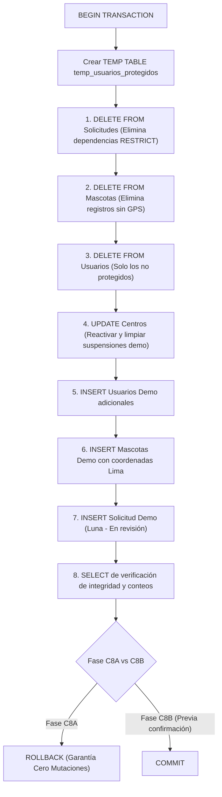

# INFORME TÉCNICO DE CIERRE — FASE C8A: INVENTARIO Y PLAN SEGURO DE REINICIO DE DATOS DEMOSTRATIVOS

**Proyecto:** AdoptMe — Plataforma de Adopción Responsable  
**Repositorio:** `D:\Escritorio D\T2_GRUPO3_ DESARROLLO_APP\AdoptMe2_Entrega4_Git`  
**Rama activa:** `feature/ux-notificaciones-centros-responsive`  
**Base de Datos:** Neon PostgreSQL 16 (Producción / Render API)  
**Fecha:** 10 de noviembre de 2026  
**Estado:** AUDITORÍA COMPLETADA — CERO MUTACIONES EFECTUADAS (SOLO LECTURA)

---

## 1. Contexto y Objetivos de la Fase C8A

La Fase C8A tiene como único propósito realizar una auditoría de solo lectura sobre la base de datos de producción en Neon PostgreSQL, identificar el estado actual de las tablas operativas, clasificar rigurosamente los registros protegidos vs. prescindibles, y diseñar un script SQL transaccional e idempotente que restablezca un conjunto de datos demostrativos coherente, con mascotas georreferenciadas con coordenadas reales de Lima para Google Maps y estados representativos.

> [!IMPORTANT]
> **Garantía de Integridad en C8A:** Durante esta fase **NO** se ejecutó ninguna sentencia de modificación (`DELETE`, `UPDATE`, `INSERT`, `TRUNCATE`, `ALTER`, `DROP`). Todas las operaciones fueron consultas `SELECT` de inspección de esquema e integridad referencial. El script SQL generado queda preparado y en espera de confirmación explícita para la Fase C8B.

---

## 2. Inventario Actual de Neon PostgreSQL

La inspección automatizada de solo lectura reportó los siguientes conteos consolidados:

| Tabla | Registros Actuales | Descripción |
| :--- | :---: | :--- |
| **`Usuarios`** | **28** | Administradores, representantes de centros y adoptantes. |
| **`Centros`** | **5** | Centros demostrativos georreferenciados en Lima Metropolitana. |
| **`Mascotas`** | **19** | Mascotas registradas históricamente (casi todas sin coordenadas GPS). |
| **`Solicitudes`** | **14** | Solicitudes de adopción de pruebas de desarrollo pasadas. |
| **`CentrosApelaciones`** | **0** | La tabla no existe aún en Neon (migración pendiente de despliegue). |

### 2.1 Esquema y Reglas de Integridad Referencial (Foreign Keys)

Se inspeccionó la tabla `information_schema.table_constraints` y `referential_constraints`:

1. `FK_Solicitudes_Mascotas_MascotaId`: `Solicitudes.MascotaId` $\to$ `Mascotas.Id`  
   *Regla:* `ON DELETE RESTRICT`.  
   *Implicancia:* No es posible borrar una mascota sin antes eliminar sus solicitudes asociadas.
2. `FK_Solicitudes_Usuarios_AdoptanteId`: `Solicitudes.AdoptanteId` $\to$ `Usuarios.Id`  
   *Regla:* `ON DELETE RESTRICT`.  
   *Implicancia:* No es posible borrar un usuario adoptante sin antes eliminar sus solicitudes.
3. `FK_Centros_Usuarios_UsuarioId`: `Centros.UsuarioId` $\to$ `Usuarios.Id`  
   *Regla:* `ON DELETE RESTRICT`.  
   *Implicancia:* Los usuarios vinculados formalmente a centros no pueden eliminarse sin antes desvincular o eliminar el centro.
4. `FK_Mascotas_Centros_CentroId`: `Mascotas.CentroId` $\to$ `Centros.Id`  
   *Regla:* `ON DELETE SET NULL`.  
5. `FK_Centros_Usuarios_RevisadoPorUsuarioId`: `Centros.RevisadoPorUsuarioId` $\to$ `Usuarios.Id`  
   *Regla:* `ON DELETE SET NULL`.  
6. `FK_Centros_Usuarios_SuspendidoPorAdminId`: `Centros.SuspendidoPorAdminId` $\to$ `Usuarios.Id`  
   *Regla:* `ON DELETE SET NULL`.

---

## 3. Clasificación de Registros Existentes

### 3.1 Lista A: Registros Protegidos (Bajo ninguna circunstancia se eliminan)

| Tabla | ID | Identificador / Correo | Nombre | Rol / Condición | Justificación |
| :--- | :---: | :--- | :--- | :--- | :--- |
| **`Usuarios`** | 5 | `admin@adoptme.com` | Administrador Demo | Admin | Administrador canónico para pruebas y evaluación del jurado. |
| **`Usuarios`** | 6 | `centro@adoptme.com` | Centro Demo | Centro | Titular vinculado al Centro #1 (`Albergue Huellitas del Norte`). |
| **`Usuarios`** | 7 | `usuario@adoptme.com` | Adoptante Demo | Adoptante | Usuario adoptante oficial para pruebas de postulación. |
| **`Usuarios`** | 3 | `arthur01961@outlook.com` | Arturo Raffo | Adoptante | Cuenta personal del desarrollador / Administrador técnico. |
| **`Centros`** | 1 | ID 1 | Albergue Huellitas del Norte - Lima (Demo) | Aprobado / Activo | SJL (GPS: -12.0089, -77.0042). Vinculado a Usuario ID 6. |
| **`Centros`** | 2 | ID 2 | Refugio Patitas Felices Surco (Demo) | Aprobado / Activo | Surco (GPS: -12.1384, -76.9856). |
| **`Centros`** | 3 | ID 3 | Centro de Adopción Miraflores (Demo) | Aprobado / Activo | Miraflores (GPS: -12.1221, -77.0305). |
| **`Centros`** | 4 | ID 4 | Hogar Temporal Ate Vitarte (Demo) | Aprobado / Activo | Ate (GPS: -12.0461, -76.9214). |
| **`Centros`** | 5 | ID 5 | Módulo Animal Comas (Demo) | Aprobado / Activo | Comas (GPS: -11.9325, -77.0542). |

### 3.2 Lista B: Registros Propuestos para Eliminación

1. **Todas las Solicitudes Actuales (14 registros):**
   - IDs: 1, 2, 3, 4, 5, 6, 7, 8, 9, 10, 11, 12, 13, 14.
   - *Motivo:* Fueron generadas en sesiones previas de prueba con mascotas sin coordenadas o usuarios residuales. Se reemplazará por 1 solicitud limpia y representativa vinculada a los nuevos datos demo.
2. **Todas las Mascotas Actuales (19 registros):**
   - IDs: 1, 2, 3, 4, 5, 6, 7, 8, 9, 10, 11, 12, 13, 14, 15, 16, 17, 18, 41.
   - *Motivo:* 18 de las 19 mascotas tienen coordenadas `Latitud = NULL` y `Longitud = NULL`, imposibilitando su renderizado en Google Maps. Se sustituirán por un conjunto controlado y balanceado con coordenadas exactas en Lima.
3. **Usuarios Adoptantes Residuales / Sintéticos (23 registros):**
   - IDs: 1, 2, 4, 8, 9, 10, 11, 12, 13, 14, 15, 16, 17, 18, 19, 20, 21, 22, 23, 24, 25, 26, 27.
   - *Motivo:* Cuentas creadas durante pruebas unitarias o de carga manual sin centros asignados.

### 3.3 Lista C: Registros Dudosos / A Decisión del Usuario

| Tabla | ID | Correo | Rol Actual | Situación Detectada | Recomendación |
| :--- | :---: | :--- | :--- | :--- | :--- |
| **`Usuarios`** | 32 | `teddy@gmail.com` | Centro | Cuenta registrada recientemente con rol `Centro`, pero **no** tiene ningún registro asociado en la tabla `Centros`. | Se incluye en la tabla temporal de protección de la propuesta para evitar borrado accidental, o puede eliminarse si el usuario confirma que fue una prueba descartable. |

---

## 4. Propuesta de Dataset Coherente

### 4.1 Usuarios Demostrativos Complementarios

Además de los usuarios protegidos (`admin@adoptme.com`, `centro@adoptme.com`, `usuario@adoptme.com`), se propone incorporar 3 adoptantes adicionales con perfil completo, reutilizando el hash de contraseña seguro existente de `usuario@adoptme.com`:

1. **Carlos Mendoza** (`carlos.mendoza@adoptme.pe`) — Tel: 987112233 — Santiago de Surco.
2. **Ana Valdivia** (`ana.valdivia@adoptme.pe`) — Tel: 987223344 — Miraflores.
3. **Lucía Paredes** (`lucia.paredes@adoptme.pe`) — Tel: 987334455 — San Juan de Lurigancho.

### 4.2 Mascotas Demostrativas con Coordenadas GPS en Lima

Cumpliendo con los requerimientos de especie (perros, gatos, conejos), estados operativos (`Disponible`, `En proceso`) y visibilidad en Google Maps:

| Mascota | Especie | Raza | Estado | Centro Asociado | Distrito / Ubicación | Latitud | Longitud | Foto HTTPS |
| :--- | :--- | :--- | :--- | :---: | :--- | :---: | :---: | :---: |
| **Rocky** | Perro | Labrador Retriever | `Disponible` | Centro 1 | San Juan de Lurigancho, Lima | `-12.0125` | `-77.0018` | Unsplash HD |
| **Mía** | Gato | Siamés | `Disponible` | Centro 3 | Miraflores, Lima | `-12.1198` | `-77.0345` | Unsplash HD |
| **Copito** | Conejo | Belier Enano | `Disponible` | Centro 2 | Santiago de Surco, Lima | `-12.1350` | `-76.9820` | Unsplash HD |
| **Luna** | Perro | Beagle | `En proceso` | Centro 4 | Ate Vitarte, Lima | `-12.0480` | `-76.9250` | Unsplash HD |
| **Simba** | Gato | Atigrado Europeo | `Disponible` | Centro 5 | Comas, Lima | `-11.9350` | `-77.0510` | Unsplash HD |
| **Tambor** | Conejo | Holandés Enano | `Disponible` | Centro 1 | San Juan de Lurigancho, Lima | `-12.0060` | `-77.0080` | Unsplash HD |

### 4.3 Solicitud Demostrativa de Muestra

- **Mascota:** Luna (ID asociada a la perrita Beagle en proceso).
- **Postulante:** Adoptante Demo (`usuario@adoptme.com`).
- **Estado:** `En revisión`.
- **Propósito:** Permitir evaluar de inmediato la pantalla de revisión de solicitudes tanto para el Administrador como para el Centro gestor.

---

## 5. Orden de Ejecución y Plan de Recuperación

### 5.1 Secuencia Transaccional Estricta

### 5.2 Plan de Contingencia y Rollback
- Si ocurre algún error de clave foránea o conectividad, el bloque `BEGIN ... ROLLBACK` asegura que Neon permanezca 100% inalterado.
- El script propuesto se encuentra almacenado localmente en:  
  [Neon_C8_Reset_Datos_Demo_PROPUESTA.sql](file:///D:/Escritorio%20D/T2_GRUPO3_%20DESARROLLO_APP/AdoptMe2_Entrega4_Git/Backend/AdoptMe.Api/Data/Neon_C8_Reset_Datos_Demo_PROPUESTA.sql)

---

## 6. Estado Final de la Fase C8A

- **Modificaciones realizadas en Neon PostgreSQL:** 0 (Cero).
- **Modificaciones en ramas o commits Git:** 0 (Cero commits, 0 push).
- **Artefactos generados:**
  1. Script SQL de propuesta: `Backend/AdoptMe.Api/Data/Neon_C8_Reset_Datos_Demo_PROPUESTA.sql`.
  2. Informe técnico de cierre: `docs/CIERRE_C8A_INVENTARIO_DATOS_DEMO.md`.

---
*Punto de detención mandatorio alcanzado. En espera de instrucciones del usuario para proceder con la ejecución en FASE C8B.*
