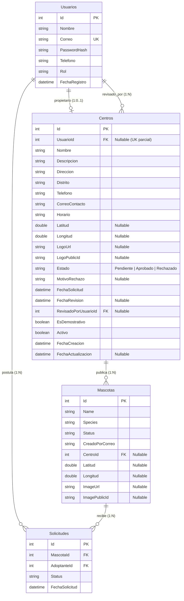
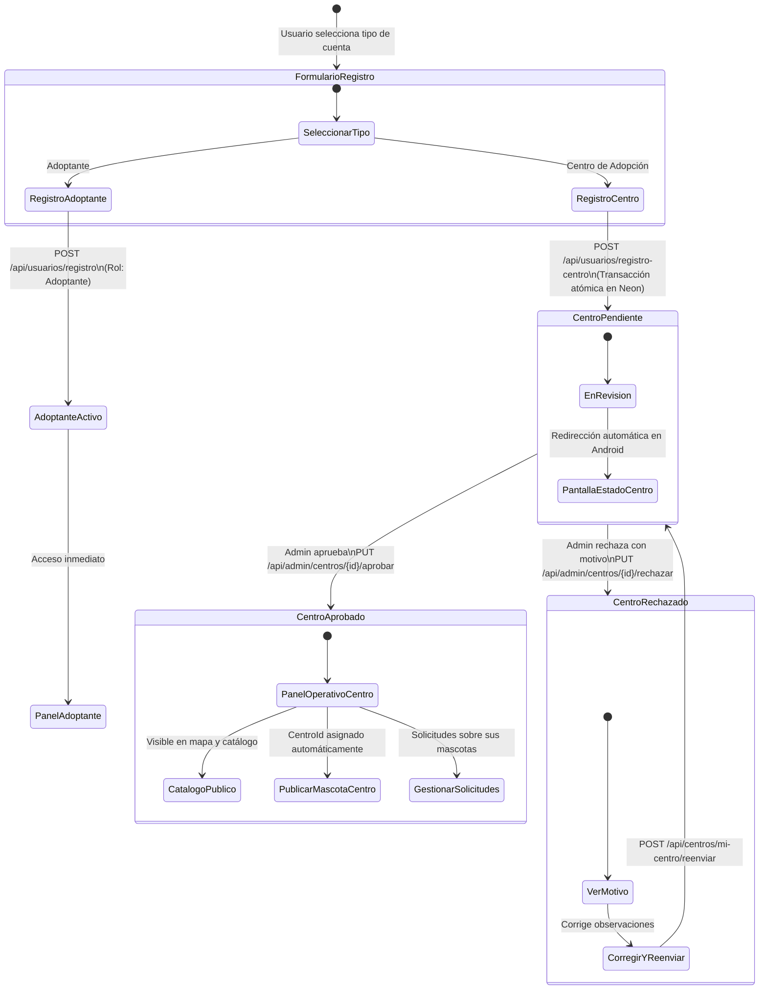
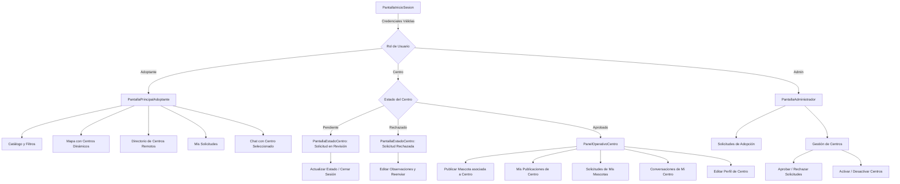

# INFORME DE AUDITORÍA Y DISEÑO DE CENTROS DINÁMICOS (FASE B)

**Proyecto:** AdoptMe — Plataforma de Adopción Responsable de Mascotas
**Entorno de Producción:** Web Service en [Render](https://adoptme2.onrender.com/) + PostgreSQL 16 en [Neon](https://neon.tech/) + CDN en [Cloudinary](https://cloudinary.com/)
**Repositorio Local:** `D:\Escritorio D\T2_GRUPO3_ DESARROLLO_APP\AdoptMe2_Entrega4_Git`
**Rama Activa:** `feature/centros-dinamicos` (creada a partir de `origin/main` en commit `91757899d7183e131937d23375e983016e09592f`)
**Fecha de Elaboración:** 2026-11-09
**Estado:** AUDITORÍA Y DISEÑO COMPLETADOS (Fase de Solo Lectura y Diseño Arquitectónico — Sin Cambios Destructivos ni Despliegues)

---

## 1. Estado Inicial de Git y Entorno

### 1.1. Verificación de Git
- **Rama Actual:** `feature/centros-dinamicos`
- **Base Exacta:** `origin/main` $\rightarrow$ Commit SHA `91757899d7183e131937d23375e983016e09592f` (`9175789` - Merge PR #2).
- **Verificación de Ancestro (`git merge-base --is-ancestor 6cd97b9 origin/main`):** Exit code `0` (Confirmado).
- **Estado del Árbol de Trabajo:** Limpio (`nothing to commit, working tree clean`).
- **Resguardo Documental:** El artefacto `INFORME_FASE_A_CLOUDINARY_PERMISOS.md` fue respaldado de forma segura fuera del repositorio en `D:\Escritorio D\T2_GRUPO3_ DESARROLLO_APP\Evidencias_Entrega4\INFORME_FASE_A_CLOUDINARY_PERMISOS.md` (35,222 bytes).

### 1.2. Estado de Infraestructura en Producción
- **Render Web Service:** `Deploy succeeded | Live` (URL: `https://adoptme2.onrender.com/`).
- **Neon PostgreSQL:** 18 mascotas históricas preservadas, 0 mascotas de prueba, esquemas íntegros.
- **Cloudinary:** 0 activos temporales huérfanos en `adoptme/mascotas`.

---

## 2. Auditoría Completa del Modelo y Esquema Actual

### 2.1. Backend (ASP.NET Core 8 Web API)
El backend cuenta con tres entidades principales registradas en `AdoptMeDbContext`:
1. `Usuario`:
   - `Id` (int PK)
   - `Nombre` (string)
   - `Correo` (string, índice único)
   - `PasswordHash` (string)
   - `Telefono` (string)
   - `Rol` (string, por defecto `"Adoptante"`)
   - `FechaRegistro` (DateTime)
2. `Mascota`:
   - `Id` (int PK)
   - `Name` (string)
   - `Species` (string)
   - `Breed` (string)
   - `Age` (string)
   - `Gender` (string)
   - `Location` (string)
   - `Status` (string, por defecto `"Disponible"`)
   - `Description` (string)
   - `ImageUrl` (string?, Cloudinary HTTPS)
   - `ImagePublicId` (string?, Cloudinary publicId)
   - `CreadoPorCorreo` (string)
   - `Latitud` (double?)
   - `Longitud` (double?)
   - `FechaCreacion` (DateTime)
3. `SolicitudAdopcion` (Mapeada a tabla `Solicitudes`):
   - `Id` (int PK)
   - `MascotaId` (int FK hacia `Mascotas(Id)`)
   - `AdoptanteId` (int FK hacia `Usuarios(Id)`)
   - Campos de formulario del solicitante (`ApplicantName`, `Phone`, `Email`, `Address`, `HousingType`, `Reason`, etc.)
   - `Status` (`"Pendiente"`, `"En revisión"`, `"Aprobada"`, `"Rechazada"`)

### 2.2. Base de Datos Neon (PostgreSQL 16 — Auditoría de Solo Lectura)
- **Tablas existentes en esquema `public`:** Únicamente 3 tablas: `Mascotas`, `Solicitudes` y `Usuarios`.
- **Claves foráneas existentes:**
  - `Solicitudes.MascotaId -> Mascotas.Id` (Restrict)
  - `Solicitudes.AdoptanteId -> Usuarios.Id` (Restrict)
- **Distribución real de usuarios por rol:**
  - `Adoptante`: 25 usuarios.
  - `Centro`: 1 usuario (ID 6: `centro@adoptme.com`).
  - `Admin`: 1 usuario (ID 5: `admin@adoptme.com`).
- **Usuario `centro@adoptme.com`:**
  - `Id`: **6**
  - `Nombre`: `"Centro Demo"`
  - `Correo`: `"centro@adoptme.com"`
  - `Rol`: `"Centro"`
  - `Telefono`: `"999777666"`
- **Mascotas asociadas a `centro@adoptme.com`:** **0**. Todas las 18 mascotas históricas fueron creadas por correos de adoptantes individuales.
- **Tablas o columnas relacionadas con "Centro":** **0**. No existe tabla `Centros` ni columna `CentroId` en ninguna tabla.
- **Tablas de Chat/Conversaciones/Mensajes:** **0**. No existe ninguna tabla de mensajería en backend ni en Neon.

### 2.3. Respuestas con Evidencia a las Preguntas de Auditoría

| Pregunta | Respuesta Técnica Auditada | Evidencia |
| :--- | :--- | :--- |
| **1. ¿Qué valores admite actualmente `Usuario.Rol`?** | Admite cadenas de texto. En base de datos existen tres roles: `"Adoptante"`, `"Centro"` y `"Admin"`. | Consulta `SELECT DISTINCT "Rol" FROM "Usuarios";` en Neon y `SeederCuentasDemo.cs`. |
| **2. ¿El rol se valida en backend o solo en Android?** | Se valida en ambos. En Backend mediante `[Authorize(Roles = "Admin")]` en `SolicitudesController` y mediante claims en `MascotasController`. En Android mediante `when (rolUsuario)` en `MainActivity.kt`. | `SolicitudesController.cs:64`, `MascotasController.cs:330`, `MainActivity.kt:880`. |
| **3. ¿El registro actual fuerza siempre Adoptante?** | **SÍ.** El endpoint `POST /api/usuarios/registro` hardcodea `Rol = "Adoptante"`. | `UsuariosController.cs:58`: `Rol = "Adoptante"`. |
| **4. ¿Un cliente podría enviar Rol = Admin?** | **NO.** `RegistroUsuarioDto` no incluye la propiedad `Rol`, por lo que el serializador la ignora y el controlador sobreescribe el rol. | `RegistroUsuarioDto.cs:8-22`. |
| **5. ¿Existe protección contra escalamiento de privilegios?** | **SÍ.** Ni el registro ni la actualización de perfil (`PUT /api/usuarios/perfil`) permiten cambiar el rol. | `UsuariosController.cs:255-260`. |
| **6. ¿Existe tabla Centros?** | **NO.** La base de datos solo contiene `Mascotas`, `Solicitudes` y `Usuarios`. | `information_schema.tables` en Neon. |
| **7. ¿Existe CentroId en Mascotas?** | **NO.** La entidad `Mascota` no contiene ninguna columna de centro. | `Mascota.cs:10-48` e `information_schema.columns`. |
| **8. ¿Cómo se relacionan solicitudes y conversaciones?** | Las solicitudes se relacionan con `Mascotas` y `Usuarios` en base de datos. Las conversaciones **no existen en backend ni base de datos**; residen 100% en Android (`AppStorage.kt`). | `AdoptMeDbContext.cs:30-50` y `AppStorage.kt:180-260`. |
| **9. ¿Se usa CreadoPorCorreo en lugar de una FK?** | **SÍ.** `Mascotas` vincula al autor mediante la columna de texto plano `CreadoPorCorreo` en vez de una clave foránea a `Usuarios(Id)`. | `Mascota.cs:38`: `public string CreadoPorCorreo`. |
| **10. ¿Qué acciones están protegidas por `[Authorize]` o roles?** | Acciones de creación, edición y borrado de mascotas, creación y consulta de solicitudes, y perfil de usuario requieren `[Authorize]`. Aprobación global de solicitudes requiere `[Authorize(Roles = "Admin")]`. | Atributos `[Authorize]` en `MascotasController` y `SolicitudesController`. |
| **11. ¿Qué acciones del Centro dependen actualmente del ID 1?** | `MainActivity.kt` inicializa `idCentroSeleccionado = 1`. `PantallaCentro.kt` fuerza `first { it.id == 1 }` y filtra `conversaciones.filter { it.idCentro == 1 }`. La respuesta simulada usa `idCentro = 1`. | `PantallaCentro.kt:80-85`, `MainActivity.kt:333, 785`. |
| **12. ¿Existe cuenta centro@adoptme.com en Neon y cuál es su UsuarioId?** | **SÍ.** Existe con `UsuarioId = 6`, `Rol = "Centro"`, `Nombre = "Centro Demo"`. | Consulta SQL a `Usuarios` WHERE Correo = 'centro@adoptme.com'. |
| **13. ¿Existen más usuarios con rol Centro?** | **NO.** Hay exactamente 1 usuario con rol Centro en toda la base de datos. | Conteo en Neon: 1 usuario con `Rol = 'Centro'`. |
| **14. ¿Existen mascotas asociadas a centros?** | **NO.** Ninguna mascota tiene `CreadoPorCorreo = 'centro@adoptme.com'`. | Conteo en Neon: 0 mascotas de centro@adoptme.com. |
| **15. ¿Qué restricciones actuales podrían romperse al introducir Centros?** | Si `CentroId` se declara `NOT NULL` en `Mascotas`, se romperían las 18 mascotas históricas y las publicaciones de adoptantes particulares. Si se exige aprobación obligatoria sin un estado "Pendiente", la cuenta existente `centro@adoptme.com` quedaría bloqueada. | Restricciones de integridad referencial en `Mascotas`. |

---

## 3. Inventario Completo de Hardcoding

Se auditaron 148 ocurrencias de datos estáticos en el repositorio. La siguiente matriz clasifica las dependencias directas del módulo de centros:

| Archivo | Ubicación | Valor Hardcodeado | Uso Actual | Riesgo | Reemplazo Dinámico Propuesto | Clasificación |
| :--- | :--- | :--- | :--- | :--- | :--- | :--- |
| `screens/CentrosScreen.kt` | Líneas 46–105 | `CentrosDemostrativos = listOf(...)` (5 centros) | Catálogo estático de centros en interfaz | Muestra datos fijos no sincronizados con base de datos | Cargar lista desde `GET /api/centros` con fallback transitorio | **Debe migrarse a Neon** |
| `screens/PantallaCentro.kt` | Líneas 65–75 | `CentrosDisponiblesDemo = listOf(...)` | Selector estático de centros | Cuentas de centro muestran información quemada | Consumir datos del centro autenticado desde `GET /api/centros/mi-centro` | **Debe eliminarse** |
| `screens/PantallaCentro.kt` | Línea 83 | `first { it.id == 1 }` | Fuerza al centro a ser siempre el Centro ID 1 | Cualquier centro autenticado ve exclusivamente el Centro 1 | Usar la entidad `Centro` asociada al token del usuario autenticado | **Debe eliminarse** |
| `screens/PantallaCentro.kt` | Línea 84 | `conversaciones.filter { it.idCentro == 1 }` | Aislamiento quemado de mensajes | No permite a otros centros gestionar sus propias conversaciones | Filtrar conversaciones por el `centroId` real del usuario | **Debe eliminarse** |
| `screens/MapaAdopcionesScreen.kt` | Línea 37 | `centros: List<CentroAdopcion> = CentrosDemostrativos` | Marcadores de mapa fijos | Nuevos centros registrados no aparecen en el mapa | Consumir centros aprobados provistos por la API | **Debe migrarse a Neon** |
| `MainActivity.kt` | Líneas 333–335 | `idCentroSeleccionado = 1`, `nombreCentro = "Albergue Huellitas..."`, `correo = "centro@adoptme.com"` | Estado global de chat en memoria | El chat solo sabe dialogar con el Centro 1 | Inicializar variables con el centro interactuado dinámicamente | **Debe eliminarse** |
| `MainActivity.kt` | Línea 785 | `idCentroSeleccionado = 1` | Reseteo quemado de conversación | Al cerrar sesión o chat fuerza ID 1 | Limpiar variables a `null` o ID dinámico | **Debe eliminarse** |
| `data/AppStorage.kt` | Líneas 32, 190 | `claveChat(correo, idCentro)` con `idCentro: Int` | Persistencia en `SharedPreferences` | Si el ID es fijo, se mezclan mensajes de centros | Conservar mecanismo pero pasando el `idCentro` real generado por Neon | **Debe conservarse como almacenamiento local** |
| `screens/PantallaRegistro.kt` | Línea 45 | `rol = "Adoptante"` | Registro quemado como adoptante | Imposibilita el autoregistro de centros de adopción | Selector de cuenta: Adoptante o Centro de Adopción | **Debe eliminarse** |
| `screens/PantallaInicioSesion.kt` | Líneas 145–155 | Botones demo: `centro@adoptme.com` / `admin@adoptme.com` | Accesos rápidos de prueba | Requieren que existan estas credenciales fijas | Mantener botones para agilizar demostraciones pedagógicas | **Debe mantenerse como dato demo** |
| `AdoptMe/*` (Subcarpeta duplicada) | Múltiples líneas | Clones de `CentrosScreen.kt`, `PantallaCentro.kt`, etc. | Código redundante en submódulo | Confusión de mantenimiento y divergencia de compilación | Documentar obsolescencia y unificar rutas hacia `com.example.adoptme.screens` | **Debe eliminarse progresivamente** |

---

## 4. Diseño del Modelo de Datos de Centros

### 4.1. Definición de la Entidad `Centro` (o `CentroAdopcion`)



### 4.2. Tabla Detallada de Campos y Validaciones

| Campo | Tipo SQL | Nulabilidad | Restricción / Validación | Propósito |
| :--- | :--- | :---: | :--- | :--- |
| `Id` | `SERIAL` (int) | `NO` | Clave primaria autoincremental | Identificador único del centro en Neon |
| `UsuarioId` | `INTEGER` | `SÍ` | `FK -> Usuarios(Id)`. Índice único parcial `WHERE "UsuarioId" IS NOT NULL` | Vinculación 1:1 con el usuario responsable. Permite `NULL` para centros demo |
| `Nombre` | `VARCHAR(150)` | `NO` | Longitud 3–150 caracteres. No vacío | Nombre legal o público del albergue/centro |
| `Descripcion` | `VARCHAR(1000)`| `NO` | Máximo 1000 caracteres | Reseña de la misión y labor del centro |
| `Direccion` | `VARCHAR(250)` | `NO` | No vacío | Dirección física de atención |
| `Distrito` | `VARCHAR(100)` | `NO` | No vacío (ej. "Miraflores", "SJL") | Distrito en Lima Metropolitana |
| `Telefono` | `VARCHAR(20)`  | `NO` | Formato numérico 7–15 dígitos | Teléfono de contacto institucional |
| `CorreoContacto`| `VARCHAR(150)`| `NO` | Formato de correo válido | Correo público visible para adoptantes |
| `Horario` | `VARCHAR(150)` | `NO` | No vacío (ej. "L-V 9:00 a 17:00") | Horario de atención al público |
| `Latitud` | `DOUBLE PRECISION`| `SÍ` | Rango [-90.0, 90.0] | Coordenada GPS geográfica |
| `Longitud` | `DOUBLE PRECISION`| `SÍ` | Rango [-180.0, 180.0] | Coordenada GPS geográfica |
| `LogoUrl` | `TEXT` | `SÍ` | URL HTTPS segura de Cloudinary | Insignia o foto del centro |
| `LogoPublicId` | `TEXT` | `SÍ` | Formato `adoptme/centros/<id>` | ID público para borrado en Cloudinary |
| `Estado` | `VARCHAR(30)` | `NO` | `CHECK (Estado IN ('Pendiente', 'Aprobado', 'Rechazado'))` | Ciclo de vida de la solicitud del centro |
| `MotivoRechazo`| `VARCHAR(500)`| `SÍ` | Requerido si `Estado == 'Rechazado'` | Feedback del administrador al rechazar |
| `FechaSolicitud`| `TIMESTAMPTZ`| `NO` | Default `CURRENT_TIMESTAMP` | Momento del registro inicial |
| `FechaRevision` | `TIMESTAMPTZ`| `SÍ` | Nullable | Momento en que el Admin evalúa |
| `RevisadoPorUsuarioId`| `INTEGER`| `SÍ` | `FK -> Usuarios(Id) ON DELETE SET NULL` | ID del Administrador evaluador |
| `EsDemostrativo`| `BOOLEAN` | `NO` | Default `FALSE` | Marca centros precargados para docencia |
| `Activo` | `BOOLEAN` | `NO` | Default `TRUE` | Permite desactivación temporal sin borrar |
| `FechaCreacion`| `TIMESTAMPTZ` | `NO` | Default `CURRENT_TIMESTAMP` | Auditoría de creación |
| `FechaActualizacion`| `TIMESTAMPTZ`| `SÍ` | Nullable | Auditoría de última modificación |

### 4.3. Reglas de Negocio del Modelo
1. **Unicidad de Centro por Usuario:** Un usuario real solo puede administrar un centro. Se garantiza mediante índice único parcial: `CREATE UNIQUE INDEX "IX_Centros_UsuarioId_Unico" ON "Centros" ("UsuarioId") WHERE "UsuarioId" IS NOT NULL;`.
2. **Consistencia por Pares en Coordenadas:** Las coordenadas deben estar ambas presentes o ambas nulas: `CHECK ((Latitud IS NULL AND Longitud IS NULL) OR (Latitud IS NOT NULL AND Longitud IS NOT NULL))`.
3. **Visibilidad Pública Estricta:** Solo los centros con `Estado = 'Aprobado'` Y `Activo = TRUE` son devueltos por `GET /api/centros` y se renderizan en el mapa interactivo de Google Maps.
4. **Protección de Datos Sensibles:** La API pública nunca expone `UsuarioId`, contraseñas ni datos personales del responsable. Solo se entregan datos institucionales (`Nombre`, `Direccion`, `Distrito`, `Horario`, `Telefono`, `CorreoContacto`, `LogoUrl`, coordenadas).

---

## 5. Estrategia para los Cinco Centros Demostrativos y la Cuenta Demo

### 5.1. Hallazgo de Auditoría
En `MainActivity.kt` línea 334 y `screens/CentrosScreen.kt` línea 50, el Centro ID 1 se denomina `"Albergue Huellitas del Norte - Lima (Demo)"`, y en el login rápido de `screens/PantallaInicioSesion.kt` el botón de Centro pre-llena `"centro@adoptme.com"`. En Neon existe exactamente una cuenta de rol Centro con dicho correo (Usuario ID 6).

### 5.2. Estrategia de Mapeo
Para no crear usuarios ficticios con contraseñas vulnerables y mantener la exposición pedagógica funcionando:
1. **Centro 1 ("Albergue Huellitas del Norte - Lima"):**
   - Se asocia a `UsuarioId = 6` (`centro@adoptme.com`).
   - `EsDemostrativo = TRUE`, `Estado = 'Aprobado'`, `Activo = TRUE`.
   - **Resultado:** La cuenta demo `centro@adoptme.com` iniciará sesión y de inmediato podrá administrar el Albergue Huellitas del Norte en vivo.
2. **Centros 2, 3, 4 y 5 (Surco, Miraflores, Ate, Comas):**
   - Se registran en Neon con `UsuarioId = NULL`.
   - `EsDemostrativo = TRUE`, `Estado = 'Aprobado'`, `Activo = TRUE`.
   - **Resultado:** Aparecerán en el catálogo y en Google Maps para los adoptantes, pero no tendrán cuentas fantasma asociadas. Únicamente un Administrador podrá editarlos o asignarles un propietario en el futuro mediante `PUT /api/admin/centros/{id}/asignar-propietario`.

### 5.3. Tabla de Migración Propuesta

| Centro Demostrativo | Distrito | Coordenadas | UsuarioId en Neon | Estado | EsDemostrativo | Acción en Migración |
| :--- | :--- | :---: | :---: | :---: | :---: | :--- |
| **Albergue Huellitas del Norte - Lima (Demo)** | San Juan de Lurigancho | -12.0089, -77.0042 | **6** (`centro@adoptme.com`) | Aprobado | `TRUE` | Vincular a cuenta demo existente 6 |
| **Refugio Patitas Felices Surco (Demo)** | Santiago de Surco | -12.1384, -76.9856 | `NULL` | Aprobado | `TRUE` | Insertar como demostrativo huérfano |
| **Centro de Adopción Miraflores (Demo)** | Miraflores | -12.1221, -77.0305 | `NULL` | Aprobado | `TRUE` | Insertar como demostrativo huérfano |
| **Hogar Temporal Ate Vitarte (Demo)** | Ate Vitarte | -12.0461, -76.9214 | `NULL` | Aprobado | `TRUE` | Insertar como demostrativo huérfano |
| **Módulo Animal Comas (Demo)** | Comas | -11.9325, -77.0542 | `NULL` | Aprobado | `TRUE` | Insertar como demostrativo huérfano |

---

## 6. Diseño del Flujo de Registro y Ciclo de Aprobación



### 6.1. Registro de Adoptante
- Conserva el flujo y contrato existente: `Nombre`, `Correo`, `Telefono`, `Contraseña`.
- Asigna `Rol = "Adoptante"` de forma segura en servidor.
- Acceso directo al Home y Catálogo.

### 6.2. Registro de Centro de Adopción
Solicita en un formulario en dos secciones:
1. **Datos del Responsable:** Nombre del representante, Correo personal/institucional, Contraseña (mínimo 6 caracteres) y Confirmación.
2. **Datos del Centro:** Nombre del centro, Descripción, Dirección, Distrito en Lima, Teléfono institucional, Correo público de contacto, Horario de atención, Coordenadas GPS (mediante botón "Usar mi GPS" o selección en mapa interactivo), Términos y condiciones.
3. **Ejecución Transaccional en Backend:**
   - Se abre una transacción en Neon:
     1. Valida que el correo no exista en `Usuarios`.
     2. Inserta `Usuario` con `Rol = "Centro"`.
     3. Inserta `Centro` con `UsuarioId = nuevoUsuario.Id`, `Estado = "Pendiente"`, `EsDemostrativo = FALSE`, `Activo = TRUE`.
     4. Confirma la transacción (`CommitAsync`).
4. **Comportamiento en Inicio de Sesión:**
   - La respuesta de `POST /api/usuarios/login` incluirá `rol: "Centro"`, `centroId: <id>`, `estadoCentro: "Pendiente" | "Aprobado" | "Rechazado"`.
   - Si `estadoCentro == "Pendiente"`: Android bloquea el acceso al panel operativo y navega a `PantallaEstadoCentro`.
   - Si `estadoCentro == "Rechazado"`: Muestra el motivo del rechazo con opción a corregir datos y reenviar.
   - Si `estadoCentro == "Aprobado"`: Despliega el `PanelCentro` completo.

---

## 7. Diseño de Endpoints de la API REST

### 7.1. Endpoints Públicos (Adoptantes y Visitantes)

#### 1. `GET /api/centros`
- **Autorización:** Anónima (Pública).
- **Filtros Aplicados en Servidor:** `WHERE "Estado" = 'Aprobado' AND "Activo" = TRUE`.
- **Query Params Opcionales:** `distrito` (string).
- **Respuesta:** `200 OK` con lista de `CentroPublicoDto`:
  ```json
  [
    {
      "id": 1,
      "nombre": "Albergue Huellitas del Norte - Lima (Demo)",
      "descripcion": "Espacio comunitario en SJL dedicado al cuidado...",
      "direccion": "Av. Próceres de la Independencia 1402, SJL",
      "distrito": "San Juan de Lurigancho",
      "telefono": "999777666",
      "correoContacto": "centro@adoptme.com",
      "horario": "Lunes a Viernes de 9:00 a 17:00",
      "latitud": -12.0089,
      "longitud": -77.0042,
      "logoUrl": null,
      "esDemostrativo": true
    }
  ]
  ```

#### 2. `GET /api/centros/{id}`
- **Autorización:** Anónima (Pública).
- **Validación:** El centro debe existir, estar `Aprobado` y `Activo`. Si está en estado Pendiente o Rechazado, devuelve `404 Not Found` para usuarios no administradores.
- **Respuesta:** `200 OK` con `CentroPublicoDto` o `404 Not Found`.

---

### 7.2. Endpoints de Registro y Autenticación

#### 3. `POST /api/usuarios/registro-centro`
- **Autorización:** Anónima.
- **Request Body:**
  ```json
  {
    "nombreResponsable": "Carlos Mendoza",
    "correo": "contacto@refugiosanfrancisco.pe",
    "contrasena": "CentroSeguro2026*",
    "telefonoResponsable": "987654321",
    "nombreCentro": "Refugio San Francisco de Asís",
    "descripcion": "Albergue sin fines de lucro en Chorrillos...",
    "direccion": "Av. Defensores del Morro 1250",
    "distrito": "Chorrillos",
    "telefonoCentro": "012548899",
    "correoContacto": "adopciones@refugiosanfrancisco.pe",
    "horario": "Martes a Domingo de 10:00 a 16:00",
    "latitud": -12.1856,
    "longitud": -77.0145
  }
  ```
- **Validaciones:**
  - Correo no registrado previamente (`409 Conflict`).
  - Coordenadas geográficas consistentes por pares y dentro de rangos (`400 BadRequest`).
  - Campos obligatorios no vacíos (`400 BadRequest`).
- **Respuesta:** `201 Created`:
  ```json
  {
    "mensaje": "Solicitud de registro de centro enviada exitosamente. Se encuentra pendiente de revisión administrativa.",
    "usuarioId": 28,
    "centroId": 6,
    "estado": "Pendiente"
  }
  ```

---

### 7.3. Endpoints de Centro Autenticado (`[Authorize(Roles = "Centro")]`)

#### 4. `GET /api/centros/mi-centro`
- **Autorización:** `[Authorize(Roles = "Centro")]`.
- **Lógica:** Obtiene el `UsuarioId` del JWT y consulta su centro asociado en Neon.
- **Respuesta:** `200 OK` con `CentroPrivadoDto` (incluye `estado`, `motivoRechazo`, `fechaSolicitud`, `fechaRevision`, etc.):
  ```json
  {
    "id": 6,
    "usuarioId": 28,
    "nombre": "Refugio San Francisco de Asís",
    "estado": "Pendiente",
    "motivoRechazo": null,
    "fechaSolicitud": "2026-11-09T23:15:00Z",
    "direccion": "Av. Defensores del Morro 1250",
    "distrito": "Chorrillos",
    "telefono": "012548899",
    "correoContacto": "adopciones@refugiosanfrancisco.pe",
    "horario": "Martes a Domingo de 10:00 a 16:00",
    "latitud": -12.1856,
    "longitud": -77.0145
  }
  ```

#### 5. `PUT /api/centros/mi-centro`
- **Autorización:** `[Authorize(Roles = "Centro")]`.
- **Lógica:** Solo el centro autenticado puede modificar sus datos.
- **Regla de Sensibilidad:** Si se modifica `Descripcion`, `Horario` o `Telefono`, conserva su aprobación. Si se altera el `Nombre` legal o se cambia sustancialmente la `Ubicacion` geográfica, el backend marca `Estado = 'Pendiente'` para salvaguardar la veracidad pública.

#### 6. `POST /api/centros/mi-centro/reenviar`
- **Autorización:** `[Authorize(Roles = "Centro")]`.
- **Lógica:** Válido únicamente si `Estado == 'Rechazado'`. Cambia a `Estado = 'Pendiente'`, borra `MotivoRechazo` y actualiza `FechaSolicitud = UtcNow`.

---

### 7.4. Endpoints de Administración (`[Authorize(Roles = "Admin")]`)

#### 7. `GET /api/admin/centros`
- **Autorización:** `[Authorize(Roles = "Admin")]`.
- **Query Params:** `estado` (`"Pendiente"`, `"Aprobado"`, `"Rechazado"` o `"Todos"`).
- **Respuesta:** `200 OK` con lista completa de centros incluyendo datos del usuario solicitante.

#### 8. `PUT /api/admin/centros/{id}/aprobar`
- **Autorización:** `[Authorize(Roles = "Admin")]`.
- **Efecto en Neon:**
  - `Estado = 'Aprobado'`
  - `FechaRevision = UtcNow`
  - `RevisadoPorUsuarioId = adminId`
  - `MotivoRechazo = NULL`
- **Respuesta:** `200 OK` (`{"mensaje": "Centro aprobado exitosamente."}`).

#### 9. `PUT /api/admin/centros/{id}/rechazar`
- **Autorización:** `[Authorize(Roles = "Admin")]`.
- **Request Body Obligatorio:**
  ```json
  {
    "motivo": "La dirección proporcionada no pudo ser verificada catastralmente."
  }
  ```
- **Validación:** `motivo` no puede ser nulo ni estar en blanco (`400 BadRequest`).
- **Efecto en Neon:**
  - `Estado = 'Rechazado'`
  - `MotivoRechazo = dto.Motivo.Trim()`
  - `FechaRevision = UtcNow`
  - `RevisadoPorUsuarioId = adminId`
- **Respuesta:** `200 OK` (`{"mensaje": "Centro rechazado con motivo registrado."}`).

#### 10. `PUT /api/admin/centros/{id}/activar` y `PUT /api/admin/centros/{id}/desactivar`
- Permite suspender temporalmente un centro aprobado del catálogo público sin eliminar su historial ni sus mascotas asociadas.

#### 11. `PUT /api/admin/centros/{id}/asignar-propietario`
- **Autorización:** `[Authorize(Roles = "Admin")]`.
- **Lógica:** Permite a un administrador asignar un usuario real con rol `Centro` a uno de los cuatro centros demostrativos huérfanos.

---

## 8. Diseño de Navegación en Android



---

## 9. Plan de Eliminación de Hardcoding (Fase C, D y E)

### 9.1. Pasos de Ejecución Segura
Para evitar que la app quede sin centros durante la transición:
1. **Paso 1 (Backend & Neon):**
   - Ejecutar la migración aprobada `Neon_Fase6_Centros_Dinamicos.sql` en Neon.
   - Implementar `CentrosController`, DTOs y pruebas unitarias de backend.
   - Desplegar en Render y verificar `GET /api/centros` respondiendo los 5 centros demo.
2. **Paso 2 (Contratos de Red en Android):**
   - Crear interfaz `CentrosApi` en Retrofit (`GET /api/centros`, `GET /api/centros/mi-centro`, etc.).
   - Modelar `CentroAdopcionResponseDto` con soporte para coordenadas y logo.
3. **Paso 3 (Transición Dinámica con Fallback Temporal):**
   - Modificar `CentrosScreen.kt` para consultar `RetrofitClient.centrosApi.obtenerCentros()`.
   - Si la red falla en el primer arranque, usar `CentrosDemostrativos` como fallback temporal de solo lectura, con botón de "Reintentar".
4. **Paso 4 (Mapa Dinámico):**
   - `MapaAdopcionesScreen.kt` recibe la lista remota de centros desde el ViewModel / State de `MainActivity`.
   - Los marcadores se dibujan a partir de los centros obtenidos por API.
5. **Paso 5 (Panel Operativo y Desacople de ID 1):**
   - `PantallaCentro.kt` se alimenta de `GET /api/centros/mi-centro`.
   - Se erradica `it.id == 1` y `idCentroSeleccionado = 1`.
   - Se eliminan las listas quemadas `CentrosDisponiblesDemo` e `InfoCentroDemo`.
   - Se retira el código redundante en la subcarpeta `AdoptMe/`.

---

## 10. Matriz de Pruebas Unitarias y de Integración Propuesta

### 10.1. Pruebas Backend Propuestas (AdoptMe.Api.Tests)
1. `RegistrarCentro_DatosValidos_CreaUsuarioYCentroPendiente`
2. `RegistrarCentro_CorreoDuplicado_RetornaConflict409`
3. `RegistrarCentro_CoordenadasIncompletas_RetornaBadRequest400`
4. `RegistrarCentro_IntentoRolAdmin_IgnoraYForzaRolCentro`
5. `ObtenerCentrosPublicos_SoloRetornaAprobadosYActivos`
6. `ObtenerCentrosPublicos_OcultaCentrosPendientesYRechazados`
7. `ObtenerCentroPorId_CentroPendiente_RetornaNotFoundParaAnonimo`
8. `AprobarCentro_AdminAutenticado_CambiaEstadoAAprobado`
9. `AprobarCentro_UsuarioNoAdmin_RetornaForbidden403`
10. `RechazarCentro_SinMotivo_RetornaBadRequest400`
11. `RechazarCentro_ConMotivo_RegistraMotivoYFechaRevision`
12. `MiCentro_CentroAutenticado_RetornaCentroPropio`
13. `MiCentro_AdoptanteIntentaAcceso_RetornaForbidden403`
14. `PublicarMascota_CentroAprobado_AsignaCentroIdAutomaticamente`
15. `PublicarMascota_CentroPendiente_RetornaForbidden403`
16. `PublicarMascota_Adoptante_AsignaCentroIdNull`
17. `ReenviarCentro_EstadoRechazado_PasaAPendiente`
18. `ReenviarCentro_EstadoAprobado_RetornaBadRequest400`

### 10.2. Pruebas Android Unitarias Propuestas
1. `RegistroViewModel_SeleccionTipoCuenta_CambiaFormularioCorrectamente`
2. `RegistroCentro_ValidacionCamposObligatorios_MuestraErrores`
3. `RegistroCentro_ValidacionCoordenadas_RequiereParCompleto`
4. `Navegacion_RolCentro_EstadoPendiente_RedirigeAPantallaEstadoCentro`
5. `Navegacion_RolCentro_EstadoRechazado_MuestraMotivoYFormularioReenvio`
6. `Navegacion_RolCentro_EstadoAprobado_AbrePanelOperativoCentro`
7. `CentrosScreen_CargaRemotaExitosa_RenderizaListaDeCentros`
8. `CentrosScreen_ErrorDeRed_MuestraBotonReintentar`
9. `MapaAdopciones_CentrosRemotos_DibujaMarcadoresConCoordenadasReales`
10. `PantallaCentro_DesacopladaDeId1_UtilizaCentroIdDinamico`

---

## 11. Línea Base de Pruebas y Compilación (Fase 13)

Se ejecutó la verificación exhaustiva de la suite de pruebas automatizadas antes y después de la auditoría:

- **Backend (`dotnet test Backend/AdoptMe.sln`):**
  - Total: **42**, Superadas: **42**, Fallidas: **0**, Omitidas: **0** (Duración: 648 ms).
- **Android (`gradlew testDebugUnitTest`):**
  - Total: **140**, Superadas: **140**, Fallidas: **0**, Omitidas: **0** (Duración: 49 s).
- **Total Integrado:** **182 / 182 pruebas unitarias superadas** (100% de éxito, 0 regresiones).

---

## 12. Recomendaciones Concretas para Decisiones Arquitectónicas (Fase 15)

1. **Nombre Final de la Tabla (`Centros` frente a `CentrosAdopcion`):**
   - **Recomendación Técnica:** Nombrar la tabla **`Centros`** y la entidad C# **`Centro`**. Es conciso, respeta la convención plural en PostgreSQL (`Usuarios`, `Mascotas`, `Solicitudes`, `Centros`) y simplifica las rutas REST (`/api/centros`).
2. **Rol `Centro` con Estado Separado frente a `CentroPendiente` como Rol:**
   - **Recomendación Técnica:** Mantener un único rol **`Centro`** en la tabla `Usuarios`, y manejar el ciclo de aprobación en la columna **`Estado`** de la tabla `Centros`. Esto evita migraciones complejas de strings en `Usuarios.Rol`, no altera el seeder existente y permite que el token JWT conserve el claim `Role = "Centro"`, delegando la autorización operativa al estado del centro.
3. **Asociación de la Cuenta `centro@adoptme.com`:**
   - **Recomendación Técnica:** Asociar formalmente `centro@adoptme.com` (Usuario ID 6) al **Centro 1 ("Albergue Huellitas del Norte - Lima")**. Las evidencias de código en Android demuestran que ambos fueron diseñados juntos. Así, la cuenta de demostración funcionará de inmediato sin credenciales inventadas.
4. **Columna `CentroId` en `Mascotas`:**
   - **Recomendación Técnica:** Agregar `CentroId INTEGER NULL` con FK a `Centros(Id) ON DELETE SET NULL`. Esto garantiza compatibilidad 100% con las 18 mascotas históricas y permite que sigan existiendo mascotas publicadas por adoptantes independientes (`CentroId = NULL`).
5. **Tratamiento de los otros Cuatro Centros Demostrativos:**
   - **Recomendación Técnica:** Migrarlos a Neon con **`UsuarioId = NULL`** y **`EsDemostrativo = TRUE`**. No inventar correos ni contraseñas para Surco, Miraflores, Ate y Comas. Permanecerán visibles públicamente en mapa y catálogo bajo la tutela del Administrador.
6. **Ediciones que Obligan Nueva Aprobación:**
   - **Recomendación Técnica:** Cambios en datos operativos menores (teléfono, horario, descripción) se aprueban automáticamente. Modificaciones críticas en el **Nombre institucional** o desplazamiento de la **Ubicación geográfica** mayor a 500 metros deben cambiar `Estado = 'Pendiente'` para evitar suplantaciones de centros reales.
7. **Inclusión de Logo mediante Cloudinary:**
   - **Recomendación Técnica:** Incluir las columnas `LogoUrl` y `LogoPublicId` en `Centros` desde el inicio para aprovechar el servicio `IImageStorageService` ya desplegado en la Fase A, permitiendo a los centros subir su fotografía institucional en la carpeta `adoptme/centros`.
8. **Campos Mínimos de Registro:**
   - **Recomendación Técnica:** Solicitar únicamente datos institucionales y de contacto reales. **No solicitar RUC ni documentación notarial por apariencia**, dado que el sistema no cuenta con integración web a la API de SUNAT para validación de vigencia de poder.
9. **Datos Públicos y Privados:**
   - **Recomendación Técnica:** `GET /api/centros` solo debe devolver un DTO público institucional. El nombre, correo personal y teléfono del representante legal deben mantenerse privados y accesibles únicamente por el Administrador.
10. **Orden Exacto de Implementación:**
    - **Fase C:** Backend (Migración Neon, Entidad `Centro`, `CentrosController`, registro multipart y endpoints admin, pruebas unitarias 42 $\rightarrow$ 60).
    - **Fase D:** Android (Nuevas pantallas `PantallaEstadoCentro`, selector en `PantallaRegistro`, consumo de `GET /api/centros`, pruebas unitarias 140 $\rightarrow$ 155).
    - **Fase E:** Integración E2E, retiro de `CentrosDemostrativos` quemados y verificación en producción.

---

## 13. Conclusión de la Fase B y Punto de Detención

Se ha completado rigurosamente la auditoría de código, base de datos y repositorios, así como el diseño integral de la arquitectura para centros dinámicos.

**Estado de Restricciones Verificado:**
- [x] No se ejecutó ningún comando SQL en Neon.
- [x] No se crearon tablas ni registros en producción.
- [x] No se modificaron variables de entorno en Render.
- [x] No se realizaron despliegues.
- [x] No se crearon commits ni pushes en Git.
- [x] La base de datos Neon conserva sus 18 mascotas y la aplicación Android conserva sus 182/182 pruebas superadas.

El proyecto se encuentra en la rama `feature/centros-dinamicos`, listo para la revisión y aprobación del diseño antes de dar inicio a la Fase C.

---

## 14. Implementación Local Fase C1 (Backend de Centros Dinámicos)

En continuidad con el diseño validado en la Fase B, se completó la implementación local del backend de centros dinámicos bajo estricto aislamiento de desarrollo (sin ejecución SQL en Neon, sin commits, sin pushes y sin despliegues en Render):

### 14.1. Archivos Creados y Modificados
- **Entidades y Contexto:**
  - `Backend/AdoptMe.Api/Models/Centro.cs`: Modelo de dominio con validaciones, auditoría y relaciones.
  - `Backend/AdoptMe.Api/Models/Mascota.cs`: Agregado `CentroId` (nullable) y navegación con `[JsonIgnore]`.
  - `Backend/AdoptMe.Api/Data/AdoptMeDbContext.cs`: Mapeo Fluent API, `DbSet<Centro>`, índices y políticas ON DELETE RESTRICT / SET NULL.
- **DTOs Implementados:**
  - `RegistroCentroDto.cs`, `ResultadoRegistroCentroDto.cs`, `CentroPublicoDto.cs`, `CentroPropietarioDto.cs`, `CentroAdminDto.cs`, `ActualizarMiCentroDto.cs`, `RechazarCentroDto.cs`, `AsignarPropietarioCentroDto.cs`, `EstadoCentroDto.cs`.
- **Servicios:**
  - `ICentroAuthorizationService.cs` y `CentroAuthorizationService.cs`: Validación desacoplada de pertenencia y estado de centros, cálculo geodésico Haversine.
  - `IImageStorageService.cs` y `CloudinaryImageStorageService.cs`: Soporte para subcarpetas controladas (`adoptme/centros`).
- **Controladores:**
  - `UsuariosController.cs`: Registro transaccional atómico `POST /api/usuarios/registro-centro`, alias `registro-adoptante`, login enriquecido con metadata de centro (`centroId`, `estadoCentro`, `centroActivo`, `esDemostrativo`).
  - `CentrosController.cs`: Directorio público (`GET /api/centros`), detalle (`GET /api/centros/{id}`), gestión del propietario (`GET /api/centros/mi-centro`, `PUT /api/centros/mi-centro` con degradación a "Pendiente" ante cambios sensibles en nombre o coordenadas > 500m, reenvío `POST /api/centros/mi-centro/reenviar`, subida de logo con rollback compensatorio en Cloudinary `PUT /api/centros/mi-centro/logo`).
  - `AdminCentrosController.cs`: Listado y filtro admin (`GET /api/admin/centros`), detalle (`GET /api/admin/centros/{id}`), aprobación (`PUT /api/admin/centros/{id}/aprobar`), rechazo motivado obligatorio (`PUT /api/admin/centros/{id}/rechazar`), activación/desactivación (`PUT /api/admin/centros/{id}/activar`, `/desactivar`), reasignación de titular (`PUT /api/admin/centros/{id}/asignar-propietario`).
  - `MascotasController.cs`: Inyección de `ICentroAuthorizationService`, preservación de firmas previas, validación estricta al publicar (adoptante $\rightarrow$ `CentroId = null`; centro aprobado $\rightarrow$ asigna su propio `CentroId`; centro no aprobado/inactivo $\rightarrow$ HTTP 403; admin $\rightarrow$ asignación controlada).
- **Pruebas y Scripts:**
  - `Backend/AdoptMe.Api.Tests/CentrosDinamicosTests.cs`: Pruebas automatizadas que validan los nuevos flujos.
  - `Backend/AdoptMe.Api/Data/Neon_Fase6_Centros_Dinamicos.sql`: Script idempotente definitivo con lookup dinámico de `centro@adoptme.com` y 5 centros demo.

### 14.2. Métricas de Pruebas Automatizadas
- **Backend (Unitarias e Integración):** 72/72 pruebas superadas (42 históricas de Fase A + 30 nuevas de Fase C1).
- **Android (Línea Base Intacta):** 140/140 pruebas superadas (0 modificaciones en código Android).
- **Total Acumulado:** **212/212 pruebas superadas**.
